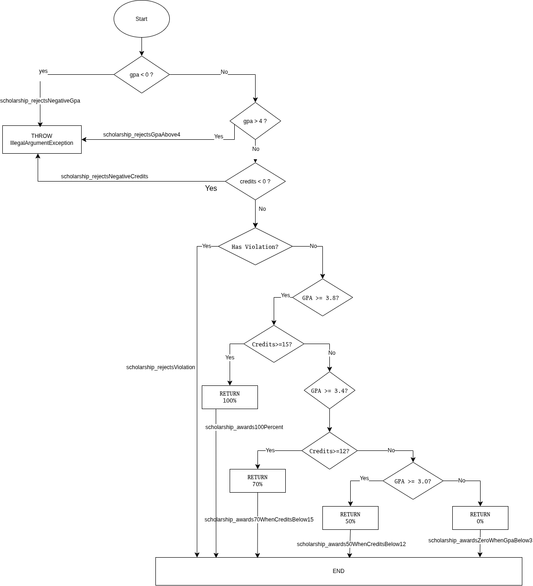

# F.CSA313 – Lab 09: JaCoCo Code Coverage

**Оюутны нэр:** С.Тэргэл  
**Оюутны код:** B232270011  
**Хичээл:** F.CSA313 – Software Quality Assurance  
**Сэдэв:** Structural Testing and JaCoCo Code Coverage

## 1. Зорилго

Энэхүү лабораторийн ажлын зорилго нь JUnit 5 ашиглан Java програмын бүтцийн тест хийх, JaCoCo хэрэгслээр Line Coverage болон Branch Coverage хэмжих, мөн Boundary Value Testing ашиглан кодын алдааг илрүүлж засах юм.

## 2. Ашигласан технологи

| Технологи | Хувилбар |
|---|---|
| Operating System | Arch Linux |
| Java | OpenJDK 17.0.21 |
| Apache Maven | 3.10.0 |
| JUnit Jupiter | 5.10.2 |
| JaCoCo | 0.8.12 |

Ашигласан Java хувилбарыг `java -version` командаар шалгасан.

```text
[heloise@arch lab08]$ java -version
openjdk version "17.0.21.0.3" 2026-10-24
OpenJDK Runtime Environment (build 17.0.21.0.3+1)
OpenJDK 64-Bit Server VM (build 17.0.21.0.3+1, mixed mode, sharing)
```

Ашигласан Maven болон Java орчны мэдээллийг `mvn -version` командаар шалгасан.

```text
[heloise@arch lab08]$ mvn -version
Apache Maven 3.10.0 (c43a36b8d67be7e0805a411bc0898af1a51f5472)
Maven home: /usr/share/java/maven
Java version: 17.0.21.0.3, vendor: Arch Linux, runtime: /usr/lib/jvm/java-17-openjdk
Default locale: en_US, platform encoding: UTF-8, time zone: Asia/Ulaanbaatar
OS name: "linux", version: "7.2.11-arch1-1", arch: "amd64", family: "unix"
```

## 3. Төслийн бүтэц

```text
lab09/
├── pom.xml
├── README.md
├── .gitignore
├── cfg.png
├── src/
│   ├── main/java/mn/edu/must/sqat/
│   │   └── ScholarshipCalculator.java
│   └── test/java/mn/edu/must/sqat/
│       └── ScholarshipCalculatorTest.java
└── results/
    ├── mvn-verify-A.txt
    ├── jacoco-A.csv
    ├── mvn-verify-B.txt
    ├── jacoco-B.csv
    ├── mvn-verify-C.txt
    ├── jacoco-C.csv
    ├── mvn-test-D-fail.txt
    ├── mvn-verify-final.txt
    └── jacoco-final.csv
```

## 4. Гүйцэтгэсэн ажлууд

### Part A – Happy Path Testing

Програмын үндсэн үйл ажиллагааг шалгах 5 happy-path тест бичсэн. `letterGrade()`, `gpa()` болон `scholarship()` method-үүдийн хэвийн ажиллагааг шалгасан.

### Part B – Branch Coverage

Гурван method-ийн нөхцөлт салааллуудыг хамрах нэмэлт тестүүд бичсэн. `if`, `else`, `switch`, `&&`, `||` нөхцөлүүдийг шалгаж, Line Coverage болон Branch Coverage-ийг 100%-д хүргэсэн.

### Part C – Loop Boundary Testing

`gpa()` method-ийн давталтыг дараах оролтуудаар шалгасан:

- 0 элементтэй массив
- 1 элементтэй массив
- 2-оос олон элементтэй массив

Эдгээр тест нь давталтын эхлэх болон дуусах үеийн ажиллагааг шалгахад тусалсан.

### Part D – Boundary Value Testing

`letterGrade()` method-ийн 60, 59.99, 69.99, 0, 100, 89.99 болон 90 онооны заагийн утгуудыг шалгасан.

60 онооны тест эхэндээ алдаа илрүүлсэн. Учир нь програмд `score > 60` нөхцөл ашигласан байсан бөгөөд 60 оноог буруу `F` гэж ангилж байв.

Үүнийг `score >= 60` болгон зассанаар 60 оноо зөв `D` болсон. Дараа нь бүх 30 тест амжилттай ажилласан.

## 5. JaCoCo эцсийн үр дүн

| Үзүүлэлт | Missed | Covered | Coverage |
|---|---:|---:|---:|
| Instructions | 0 | 152 | 100% |
| Branches | 0 | 41 | 100% |
| Lines | 0 | 25 | 100% |
| Complexity | 0 | 26 | 100% |
| Methods | 0 | 4 | 100% |

## 6. Тестийн үр дүн

| Хэсэг | Тестийн тоо | Үр дүн |
|---|---:|---|
| Part A | 5 | PASS |
| Part B | 21 | PASS |
| Part C | 23 | PASS |
| Part D | 30 | 1 FAIL – boundary bug илрүүлсэн |
| Final | 30 | PASS |

## 7. Control Flow Graph

`scholarship()` method-ийн Control Flow Graph зургийг доор оруулсан.



## 8. Дүгнэлт

Энэхүү лабораторийн ажлаар JUnit 5 ашиглан бүтцийн тест бичиж, JaCoCo хэрэгслээр Line Coverage болон Branch Coverage-ийг хэмжиж сурсан. Бүх салааллыг тестээр хамруулснаар 100% Line Coverage болон 100% Branch Coverage-д хүрсэн. Гэсэн хэдий ч 100% coverage нь програмын бүх логик зөв гэсэн баталгаа биш болохыг 60 онооны boundary bug харуулсан. Boundary Value Testing ашигласнаар уг алдааг илрүүлж, `score > 60` нөхцөлийг `score >= 60` болгон зассан. Эцсийн байдлаар 30 тест бүгд амжилттай ажилласан.

## 9. AI ашигласан тухай

ChatGPT-ийг лабораторийн ажлын явцад JaCoCo coverage, JUnit тестийн бүтэц болон Boundary Value Testing-ийн талаар ойлголт авах, тестийн хувилбар боловсруулах, README-ийн тайлбар бэлтгэхэд туслах зорилгоор ашигласан. Кодыг ажиллуулж, тестийн үр дүнг шалгах ажлыг өөрийн орчинд гүйцэтгэсэн.

## 10. Ажиллуулах

Бүх тестийг ажиллуулж JaCoCo тайлан үүсгэх:

```bash
mvn clean verify
```

HTML тайлан:

```text
target/site/jacoco/index.html
```

CSV тайлан:

```text
target/site/jacoco/jacoco.csv
```

### Feedback засвар
### D хэсэг — Boundary Value Testing: Унасан тест

Boundary value testing хийх үед 60 гэсэн заагийн утгыг шалгасан тест амжилтгүй болсон.

- **Унасан тест:** `letterGrade_60ShouldBeD`
- **Алдааны мөр:** `expected: <D> but was: <F>`
- **Log дахь мөр:** `ScholarshipCalculatorTest.letterGrade_60ShouldBeD:145`

Энэ нь 60 оноог D гэж буцаах ёстой байтал F буцааж байсныг харуулж байна. Алдаа нь `score > 60` гэсэн нөхцөлөөс үүссэн. Үүнийг `score >= 60` болгон зассанаар 60 онооны заагийн утгыг зөв боловсруулдаг болсон.

### C хэсэг — Loop Boundary Testing

C хэсэгт GPA тооцоолох `gpa()` функцийн давталтыг 0, 1 болон 2-оос дээш элементтэй массив ашиглан шалгасан. Эдгээр тест JaCoCo-ийн хамралтын хувийг нэмэгдүүлээгүй боловч давталт огт ажиллахгүй байх, нэг удаа ажиллах болон олон удаа давтагдах үеийн ажиллагааг баталгаажуулсан. Ингэснээр хоосон массив, ганц элементтэй болон олон элементтэй оролтын үед тооцоолол зөв ажиллаж байгааг шалгах боломжтой болсон.

### Дүгнэлт — 100% Branch Coverage-ийн хязгаарлалт

100% branch coverage байсан ч программд алдаа үлдэх боломжтой. Учир нь branch coverage нь нөхцөл бүрийн True болон False салааллыг шалгадаг боловч бүх боломжит оролтын утга, ялангуяа заагийн утгуудыг бүрэн шалгадаггүй. Жишээлбэл, `score > 60` гэсэн нөхцөл True болон False үр дүнгээрээ шалгагдсан байсан ч яг 60 гэсэн утгыг тестлээгүй бол `score >= 60` байх ёстой алдаа илрэхгүй үлдэж болно. Энэ лабораторийн D хэсэгт `letterGrade_60ShouldBeD` тест уг алдааг илрүүлсэн. Иймээс branch coverage-ийг boundary value testing-тэй хослуулснаар заагийн утгууд дээрх алдааг илүү сайн илрүүлэх боломжтой.
